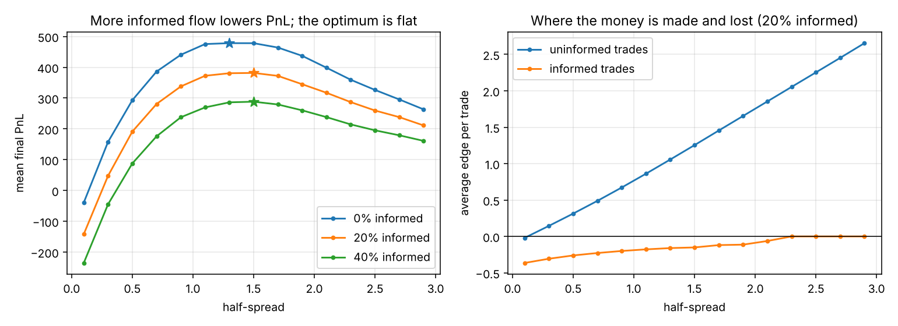
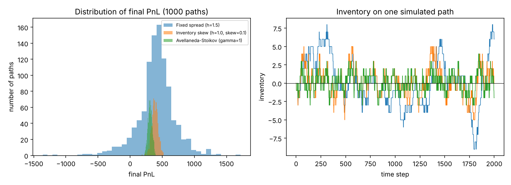
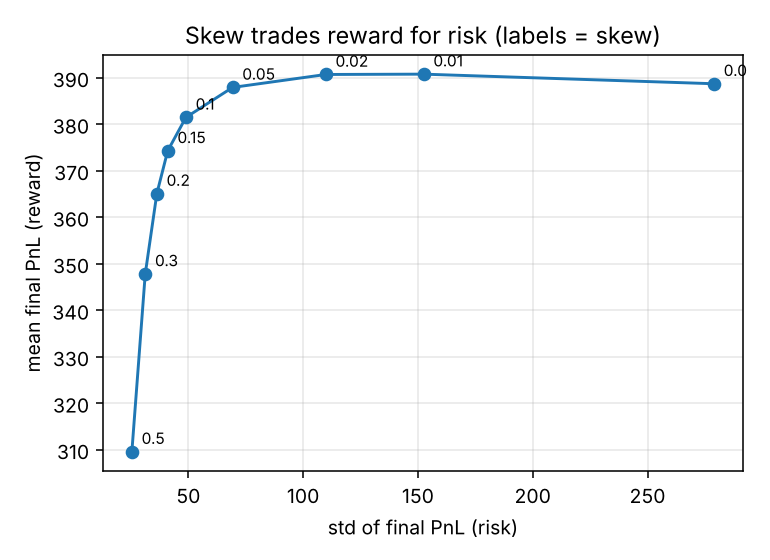

# Market-Making Simulator

A small Python simulation of a **market maker** who continuously quotes a bid and an ask, trades against a stream of random traders, and tries to make money without taking on too much inventory risk.

I built it to understand three ideas that sit at the heart of electronic market making:

1. **Spread capture**: you earn money by buying at the bid and selling at the ask.
2. **Adverse selection**: some traders know more than you, and they trade exactly when your quote is wrong.
3. **Inventory risk**: every unbalanced position is a bet on the price, so a good quoting strategy manages it.

Everything is synthetic and deliberately simple. It is a learning project, not a trading system.

## The model

Time moves in discrete steps. In each step:

1. The market maker posts a **bid** and an **ask** around the last fair value it observed.
2. The true fair value moves: `V_t = V_{t-1} + sigma * N(0, 1)`.
3. With probability `arrival_prob`, one trader (always for one unit) arrives:
   - **Informed trader** (probability `informed_frac`): already knows `V_t`. Buys if our ask is below `V_t`, sells if our bid is above `V_t`, otherwise does nothing.
   - **Uninformed trader**: picks buy or sell at random and trades with probability `min(1, exp(-k * d))`, where `d` is how far our quote is from the true value. Wider quotes mean fewer trades.
4. The market maker then observes `V_t` and uses it as the new reference price.

Because we always quote around the *previous* price, informed traders can pick us off after a large move. That is the adverse selection. Quotes that are too tight lose money to it; quotes that are too wide lose the uninformed flow.

PnL is marked to the true fair value: `cash + inventory * V_t`.

Default parameters (`mm_sim/params.py`): `sigma = 0.5`, `steps = 2000`, `arrival_prob = 0.8`, `informed_frac = 0.2`, `k = 1.0`. These are arbitrary round numbers, not calibrated to any real market.

## Strategies

| Strategy | Idea |
|---|---|
| `FixedSpread(h)` | Quote `ref - h` / `ref + h`. No inventory control. |
| `InventorySkew(h, skew, max_inventory)` | Shift both quotes down when long and up when short (`skew` per unit of inventory); stop quoting the side that would push inventory past the limit. |
| `AvellanedaStoikov(gamma, k, sigma)` | Reservation price and spread from the Avellaneda-Stoikov (2008) model, using a stationary simplification (the `T - t` factor is fixed to 1). `gamma` is risk aversion. |

## Results

Reproduce everything with `python run_experiments.py` (all runs are seeded).

### 1. How wide should a fixed spread be?



- Mean PnL is hump-shaped in the half-spread. Very tight quotes lose money (at `h = 0.1` the average is negative), because they trade a lot but earn almost nothing per trade, and informed traders take the edge.
- With 20% informed flow the best fixed half-spread on my grid is about 1.5. The curve is very flat near the top, so I would not read much into whether the optimum is 1.3 or 1.5 for different informed shares. What is clear is that more informed flow lowers PnL at every spread.
- Right panel: the average edge on uninformed trades grows roughly linearly with the spread, while the edge on informed trades is negative for every spread below about 2.2 (more than 4 standard deviations of a single move), and zero beyond that because informed traders no longer find anything to trade against.

### 2. Does inventory control help?

Evaluated on 1000 paths with a seed that was not used to choose the parameters:

| Strategy | mean PnL | std PnL | 5th pct PnL | avg max drawdown | avg \|inventory\| | max \|inventory\| | trades/path |
|---|---:|---:|---:|---:|---:|---:|---:|
| Fixed spread (h=1.5) | 405.7 | 291.8 | -95.3 | 232.9 | 9.6 | 64.0 | 323.8 |
| Inventory skew (h=1.0, skew=0.1) | 384.1 | 50.0 | 303.4 | 25.8 | 1.7 | 11.0 | 556.6 |
| Avellaneda-Stoikov (gamma=1) | 309.7 | 33.0 | 253.5 | 13.7 | 1.1 | 8.0 | 696.6 |



- The fixed-spread strategy has the highest average PnL but a very wide distribution: about one path in twenty ends below -95, and inventory reaches 64 units at its worst.
- The skewed strategy gives up about 5% of the average PnL and cuts the standard deviation by roughly a factor of six. Its worst 5% of paths still end above 300.
- Avellaneda-Stoikov is the most conservative of the three: lowest risk, lowest average PnL. It is another point on the same risk/reward trade-off rather than a strictly better or worse strategy.
- Caveat: the first row uses `h = 1.5` and the others use `h ≈ 1.0` (`0.8` for Avellaneda-Stoikov), so this table mixes the effect of the spread with the effect of inventory control. The next experiment isolates the skew.

### 3. The price of lower risk

Holding the half-spread at 1.0 and varying only the skew:



With no skew the standard deviation of final PnL is about 279 and the mean is about 389. At `skew = 0.1` the standard deviation drops to about 49 while the mean is still about 382. Beyond that, extra skew keeps reducing risk but the mean falls noticeably (about 310 at `skew = 0.5`). In this setup a small amount of skew is almost free; a lot of it is expensive.

## Limitations

- **Synthetic market.** The price is a random walk and traders follow simple rules. There is no real data, so none of this says anything about real profitability.
- **Information model.** Informed traders know the next fair value exactly and the market maker is always one step behind. Real adverse selection is subtler.
- **Fill model.** The exponential fill probability follows the spirit of Avellaneda-Stoikov but is an assumption.
- **No market microstructure.** No order book, queue position, latency, fees, or order sizes other than 1.
- **Parameters picked by hand**, looking at one seed and then checked on another, not optimised. The numbers above would change with different parameters.
- **`mean / std`** in the code is a simple ratio across simulated paths, not an annualised Sharpe ratio.
- **Avellaneda-Stoikov is simplified** (no finite horizon).

## Ideas for extending it

- Let the informed signal be noisy or lagged by more than one step.
- Make order size random and add a position-dependent fee.
- Model a limit order book with queue priority.
- Tune strategy parameters with a proper train/test split.
- Replace the random-walk price with real historical data.

## Running it

```bash
pip install -r requirements.txt
python run_experiments.py        # regenerates the figures and results/summary.md
python -m unittest discover -v   # runs the 12 tests
```

```python
from mm_sim import MarketParams, InventorySkew, simulate, summarize

result = simulate(InventorySkew(half_spread=1.0, skew=0.1, max_inventory=25),
                  MarketParams(), n_paths=500, seed=0)
print(summarize(result))
```

## Project layout

```
mm_sim/
  params.py       market parameters
  market.py       the simulator (vectorised over paths)
  strategies.py   FixedSpread, InventorySkew, AvellanedaStoikov
  metrics.py      summary statistics
tests/            unit tests (PnL identity, inventory cap, reproducibility, ...)
run_experiments.py  produces everything in results/
results/          figures and summary table
```

## Reference

M. Avellaneda and S. Stoikov, "High-frequency trading in a limit order book", *Quantitative Finance* 8(3), 2008.
